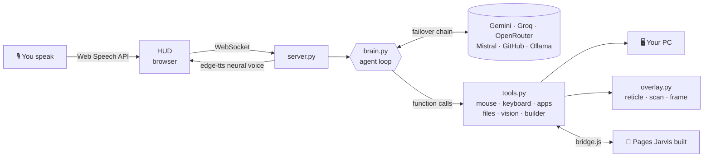

<div align="center">

# J.A.R.V.I.S. · Iron Man Mode

### Talk to your PC. It talks back, sees your screen, moves your mouse, and builds things for you.


**[Quick start](#-quick-start-2-minutes)** · **[Free AI keys](#-free-ai-keys)** · **[What to say](#%EF%B8%8F-things-to-say)** · **[How it works](#-how-it-works)** · **[Troubleshooting](#%EF%B8%8F-troubleshooting)**

</div>

---

## ✨ What it does

| | |
|---|---|
| 🎙️ **Voice in, voice out** | Say *"Jarvis, …"*. It answers in a British AI voice, in English, French or Arabic. |
| 🖱️ **Controls your PC** | Opens apps, types, clicks buttons it *sees*, scrolls, uses shortcuts, and controls media and windows. |
| 👁️ **Sees your screen** | *"What's on my screen?"* · *"Click the blue Sign-in button"*: a targeting reticle locks on, then it clicks. |
| 📷 **Sees *you*** | *"What am I holding?"*: the webcam feed appears in the HUD, targeting boxes lock onto objects, and Jarvis answers with a joke. |
| 😏 **Has a personality** | Witty British butler, helpful first and funny second. Edit `personality.md` and it changes on your next sentence. |
| 🏗️ **Builds apps live** | *"Build a snake game"*: you watch the code stream in the HUD, then it opens in VS Code and the browser. |
| 🎤 **Presents like a human** | *"Present it"*: it scrolls slide by slide, points with the mouse, clicks the buttons, and narrates. |
| 🎨 **Reshapes itself** | *"Go Iron Man mode"* / *"turn green"*: the whole interface and the desktop effects recolor live. |
| 🧠 **Never runs out** | Chains every free AI key you give it (Gemini, Groq, OpenRouter, Mistral, GitHub) and switches automatically. |

<div align="center">

<br><sub><i>"Jarvis, go Hulk mode." Every color in the HUD is live.</i></sub>
</div>

---

## 🚀 Quick start (2 minutes)

> **You need:** Windows 10/11 or Linux ([see below](#-linux)) · internet · a microphone · **one free AI key** (1 minute to get, see below). **That's it.**

**1. Download.** Click the green **Code** button, choose **Download ZIP**, and **extract** it (right-click → *Extract All*). Or:
```bash
git clone https://github.com/SeifEddineMezned/JARVIS.git
```

**2. Get a free key.** Go to **[aistudio.google.com/apikey](https://aistudio.google.com/apikey)**, sign in with Google, click **Create API key**, and copy it.

**3. Double-click `start.bat`.** It installs **everything** by itself (Python if you don't have it, plus all of Jarvis's packages, about 2 minutes the first time), then asks you to **paste your key**. It checks that the key works and launches Jarvis.

**4.** The HUD opens. Click **INITIALIZE**, click **Allow** for the microphone, and say:

> ### *"Jarvis, show me what you can do."*

Next time, just double-click `start.bat`. It skips everything already installed and launches in seconds.

### 🐧 Linux

Linux support lives on the `linux-support` branch of [cyborgcode/JARVIS](https://github.com/cyborgcode/JARVIS) (a fork of this project), so clone that branch:

```bash
git clone -b linux-support https://github.com/cyborgcode/JARVIS.git
cd JARVIS
bash start.sh
```

Tested on Ubuntu 26.04 (GNOME, Wayland). Other Debian/Ubuntu-based distros and X11 sessions use the same script but haven't been tested yet.

`start.sh` does what `start.bat` does: installs the few system packages it needs (it asks for your password once), creates the private Python environment, asks for your key, and offers to install **Google Chrome**, which voice input needs (Firefox has no speech recognition, and Chromium usually lacks Google's speech keys). Without Chrome you can still type commands.

**Wayland (Ubuntu's default):** apps can't control the mouse or see the screen without asking, so on the first launch your desktop asks to share the screen. Pick your screen, **switch on "Allow remote interaction"**, and click **Share**. Jarvis remembers this, so you won't be asked again. A remote-control indicator stays in the top bar while Jarvis runs; stopping it there is the emergency stop.

**Known limits on Wayland:**
- Slamming the mouse into a screen corner does **not** stop Jarvis: Wayland never tells apps where the real pointer is. Use the top-bar indicator or **ESC** in the HUD.
- For the same reason, if you move the mouse yourself, Jarvis's next movement starts from where it last left the pointer (a small jump, then the usual glide).
- Scrolling goes to the middle of the screen, since Wayland doesn't reveal where other windows are.
- While presenting a page (*"present it"*), the pointer can sit slightly off (about the height of the top bar), because browsers on Wayland report their window position as 0,0.

---

## 🔑 Free AI keys

You need **one** key (`start.bat` asks for it). **Want more free requests?** Open the `.env` file with Notepad and paste extra keys: Jarvis chains all of them and switches the moment one is busy or out of quota (watch the **NEURAL CORES** panel).

| Provider | Free tier\* | Card? | Get a key (≈1 min) |
|---|---|:-:|---|
| ⭐ **Google Gemini** | ~20 requests/day **per model** (Jarvis rotates 6 models). Best screen vision. | No | [aistudio.google.com/apikey](https://aistudio.google.com/apikey) |
| ⭐ **Groq** | ~1,000+ requests/day, extremely fast | No | [console.groq.com/keys](https://console.groq.com/keys) |
| **OpenRouter** | 50 requests/day on free models | No | [openrouter.ai/keys](https://openrouter.ai/keys) |
| **Mistral** | free "Experiment" plan | No (phone) | [console.mistral.ai/api-keys](https://console.mistral.ai/api-keys) |
| **GitHub Models** | ~50–150 requests/day with any GitHub account | No | [github.com/settings/personal-access-tokens](https://github.com/settings/personal-access-tokens) (permission `models:read`) |
| 🏠 **Ollama** (advanced) | Unlimited · offline · private, but needs a strong PC | — | Install [ollama.com](https://ollama.com), run `ollama pull qwen3-vl:4b`, set `OLLAMA_MODEL=qwen3-vl:4b` |

<sub>\*Free tiers change often. Check each provider's page. One voice command uses about 2–4 requests.</sub>

**Recommended:** `GEMINI_API_KEY` + `GROQ_API_KEY`, both free with no card.

```ini
# .env  (created by start.bat, git-ignored: never commit it!)
GEMINI_API_KEY=AIza...
GROQ_API_KEY=gsk_...
```

---

## 🗣️ Things to say

Start with **"Jarvis, …"**, or hold **SPACE** and just talk.

| Try this | What happens |
|---|---|
| *"How's my computer doing?"* | Live CPU / RAM / disk / top processes |
| *"What's the weather in Tunis?"* | Live weather |
| *"Show me what you can do."* | Takes over the mouse and draws an arc reactor in the air |
| *"Go Iron Man mode."* · *"Turn green."* · *"Minimal mode."* | The whole HUD transforms live |
| *"Open Paint and draw a star."* | Opens Paint, maximizes it, draws |
| *"Play Back in Black on YouTube."* · *"Pause it."* · *"Volume down."* | Media control |
| *"Build a landing page for a coffee shop called Stark Brew."* | Code streams in the HUD, then opens in VS Code + browser |
| *"Build a 5-slide presentation about AI agents."* then *"Present it."* | Scrolls, points, clicks and narrates each slide |
| *"Make it dark mode with a pricing section."* | Edits what it built |
| *"Write a Python script for the first 20 Fibonacci numbers and run it."* | Writes the file and runs it (PowerShell on Windows, bash on Linux) |
| *"What's on my screen?"* · *"Click the search box."* | Screen vision + targeted click |
| *"What am I holding?"* · *"How many fingers am I holding up?"* · *"Read what's on this paper."* | Webcam vision with targeting boxes |
| *"Tell me about yourself."* · *"I'm so tired."* | Personality: expect sarcasm, served politely |

**Controls:** `SPACE` hold to talk · `ESC` stop talking / stop the presentation · **slam the mouse into a screen corner** = emergency stop (on Linux Wayland: stop the screen sharing from the top bar).
Showcase mode (themes cycle automatically): open `http://localhost:8765/#autoboot-demo-cycle`.

---

## 🧩 How it works



| File | What it does |
|---|---|
| `brain.py` | The agent loop: the AI decides which tools to call, chains steps, never repeats itself, fails over between providers |
| `providers.py` | One interface for Gemini + any OpenAI-compatible API. Adding a provider takes about 5 lines. |
| `tools.py` | Every capability is a plain Python function + a JSON schema |
| `overlay.py` | Transparent, click-through window that draws effects over your real desktop (Tk on Windows, GTK on Linux) |
| `wayland.py` | Linux Wayland: mouse, keyboard and screenshots through the desktop's screen-sharing portal |
| `server.py` | FastAPI + WebSockets, neural voice, telemetry, page bridge |
| `static/` | The HUD (canvas arc reactor, voice, live theming) and `bridge.js` for presenting pages |

### Add your own power in 30 seconds

```python
# tools.py
def tell_joke(ctx, topic: str = "robots") -> dict:
    return {"joke": f"Why did the {topic} cross the road? To get to the other API."}

TOOLS["tell_joke"] = (tell_joke, "Tell a joke about a topic.", {"topic": {"type": "string"}}, [])
```
Restart, then say *"Jarvis, tell me a joke about Python."* The AI discovers the new tool by itself.

---

## 🛠️ Troubleshooting

| Problem | Fix |
|---|---|
| Windows says "Windows protected your PC" | **More info → Run anyway** (it's a plain `.bat` + `.ps1` script, so you can read them first) |
| Setup stopped halfway (Wi-Fi dropped…) | Just double-click `start.bat` again. Finished steps are skipped. |
| "That key was rejected" | Copy the **whole** key again from the provider's page, then paste it with a right-click in the black window |
| I want to change my key | Open `.env` with Notepad, replace the key after `GEMINI_API_KEY=`, save, and restart `start.bat` |
| Jarvis doesn't hear me | Use **Edge or Chrome**, click **Allow** for the mic, check the **MIC** chip. Hold **SPACE** to talk without the wake word. |
| The grey text says `heard: "…"` | The mic works, but you didn't start with "Jarvis". Say it first, or hold SPACE. |
| "This HUD is on standby" | Another Jarvis window is open. Only one listens at a time. Click to take control. |
| "Out of free quota" | Add another free key to `.env` (Groq is the most generous) and restart `start.bat` |
| Jarvis clicks the wrong spot | Make sure the target is visible on your **main** monitor. Gemini gives the most accurate vision. |
| Something goes wrong mid-action | **Slam the mouse into a screen corner** (fail-safe), or press **ESC**. Linux Wayland: stop the screen sharing from the top bar. |
| Linux: Jarvis can't click or type | In the sharing dialog, **"Allow remote interaction"** must be on. Delete the `.portal_token` file and restart to be asked again. |
| Linux: no desktop effects (HUD shows **OVERLAY PROJECTION: OFFLINE**) | They need a compositing desktop (GNOME and KDE are) and `python3-gi-cairo`, which `start.sh` installs. |
| Linux: `open Paint` doesn't work | Ubuntu has no paint app by default. Install one, e.g. `sudo apt install drawing`. |
| "Camera unavailable" | Click **Allow** for the camera in the HUD (asked the first time), and close other apps using the webcam (Zoom, Teams…) |

**Safety:** Jarvis only runs while `start.bat` (or the `start.sh` terminal) is open, refuses obviously destructive commands, and asks before closing unsaved work. Your keys stay in your local `.env`.

**Privacy:** the webcam turns on **only** when you ask Jarvis to look at you. A single snapshot is sent to your AI provider (nothing is recorded), and the camera switches off after 20 seconds. Screenshots for screen vision work the same way.

---

<div align="center">

Built By Seif Eddine Mezned · Licensed **Apache 2.0**

<sub>Fan-made educational project. Not affiliated with Marvel or Disney.</sub>

</div>
